<!-- Every image here is generated by scripts/build.py and refreshed daily by .github/workflows/refresh.yml -->

  <a href="https://www.sepantapouya.com/"><picture><source media="(prefers-color-scheme: dark)" srcset="assets/hero-dark.svg"><source media="(prefers-color-scheme: light)" srcset="assets/hero-light.svg"></picture></a>

  <picture><source media="(prefers-color-scheme: dark)" srcset="assets/s-work-dark.svg"><source media="(prefers-color-scheme: light)" srcset="assets/s-work-light.svg">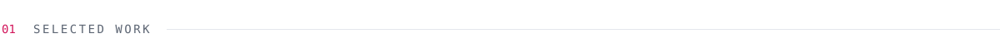</picture>

  <a href="https://kashi.sepantapouya.com"><picture><source media="(prefers-color-scheme: dark)" srcset="assets/kashi-dark.svg"><source media="(prefers-color-scheme: light)" srcset="assets/kashi-light.svg"></picture></a>

  <a href="https://github.com/Sepantapouya/Exportease"><picture><source media="(prefers-color-scheme: dark)" srcset="assets/exportease-dark.svg"><source media="(prefers-color-scheme: light)" srcset="assets/exportease-light.svg">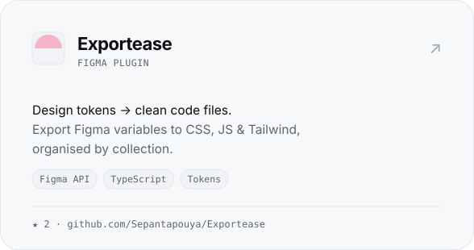</picture></a>
  <a href="https://toad-redesigned.vercel.app"><picture><source media="(prefers-color-scheme: dark)" srcset="assets/toad-dark.svg"><source media="(prefers-color-scheme: light)" srcset="assets/toad-light.svg">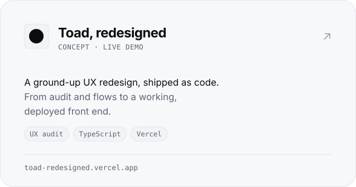</picture></a>

  <a href="https://www.sepantapouya.com/"><picture><source media="(prefers-color-scheme: dark)" srcset="assets/site-dark.svg"><source media="(prefers-color-scheme: light)" srcset="assets/site-light.svg">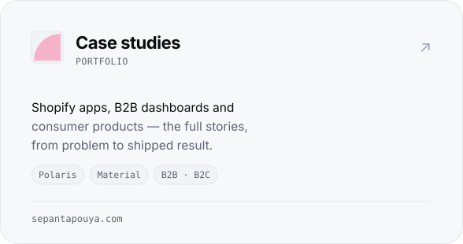</picture></a>
  <a href="https://sepantapouya.medium.com/"><picture><source media="(prefers-color-scheme: dark)" srcset="assets/ux-dark.svg"><source media="(prefers-color-scheme: light)" srcset="assets/ux-light.svg">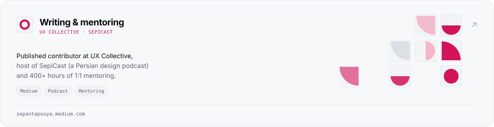</picture></a>

  <picture><source media="(prefers-color-scheme: dark)" srcset="assets/s-toolkit-dark.svg"><source media="(prefers-color-scheme: light)" srcset="assets/s-toolkit-light.svg"></picture>

  <picture><source media="(prefers-color-scheme: dark)" srcset="assets/toolkit-dark.svg"><source media="(prefers-color-scheme: light)" srcset="assets/toolkit-light.svg">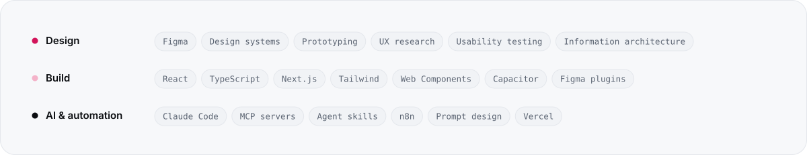</picture>

  <picture><source media="(prefers-color-scheme: dark)" srcset="assets/s-elsewhere-dark.svg"><source media="(prefers-color-scheme: light)" srcset="assets/s-elsewhere-light.svg">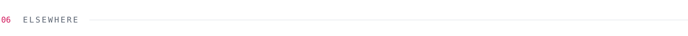</picture>

  <a href="https://www.sepantapouya.com/"><picture><source media="(prefers-color-scheme: dark)" srcset="assets/btn-website-dark.svg"><source media="(prefers-color-scheme: light)" srcset="assets/btn-website-light.svg"></picture></a>&nbsp;<a href="https://www.linkedin.com/in/sepantapouya/"><picture><source media="(prefers-color-scheme: dark)" srcset="assets/btn-linkedin-dark.svg"><source media="(prefers-color-scheme: light)" srcset="assets/btn-linkedin-light.svg"></picture></a>&nbsp;<a href="https://sepantapouya.medium.com/"><picture><source media="(prefers-color-scheme: dark)" srcset="assets/btn-medium-dark.svg"><source media="(prefers-color-scheme: light)" srcset="assets/btn-medium-light.svg">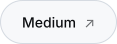</picture></a>&nbsp;<a href="https://dribbble.com/Sepantapouya"><picture><source media="(prefers-color-scheme: dark)" srcset="assets/btn-dribbble-dark.svg"><source media="(prefers-color-scheme: light)" srcset="assets/btn-dribbble-light.svg">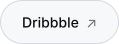</picture></a>&nbsp;<a href="https://open.spotify.com/show/2UP7K0qo2JenBPUTsXFrNI"><picture><source media="(prefers-color-scheme: dark)" srcset="assets/btn-podcast-dark.svg"><source media="(prefers-color-scheme: light)" srcset="assets/btn-podcast-light.svg">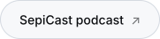</picture></a>&nbsp;<a href="https://t.me/sepantagraphy"><picture><source media="(prefers-color-scheme: dark)" srcset="assets/btn-telegram-dark.svg"><source media="(prefers-color-scheme: light)" srcset="assets/btn-telegram-light.svg">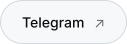</picture></a>&nbsp;<a href="https://twitter.com/sepantapouya"><picture><source media="(prefers-color-scheme: dark)" srcset="assets/btn-x-dark.svg"><source media="(prefers-color-scheme: light)" srcset="assets/btn-x-light.svg">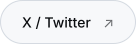</picture></a>

  <picture><source media="(prefers-color-scheme: dark)" srcset="assets/footer-dark.svg"><source media="(prefers-color-scheme: light)" srcset="assets/footer-light.svg"></picture>

